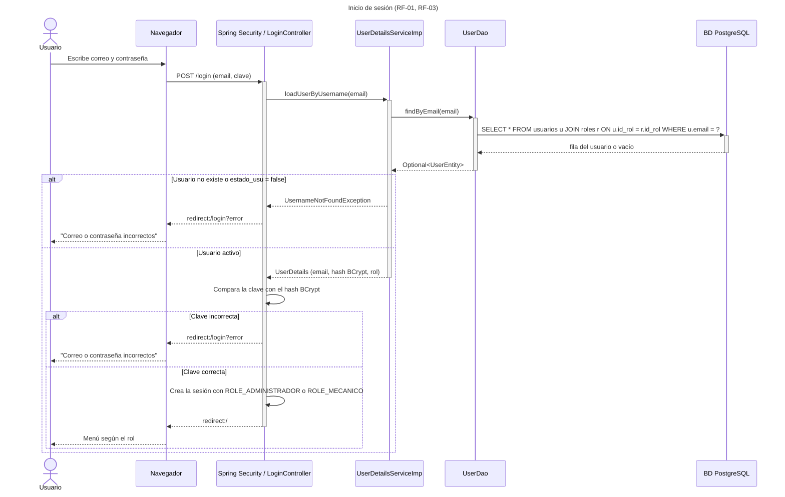
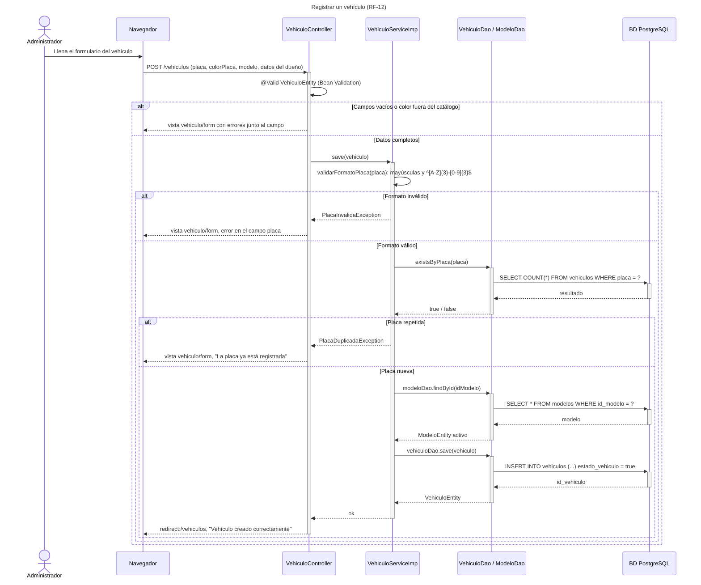
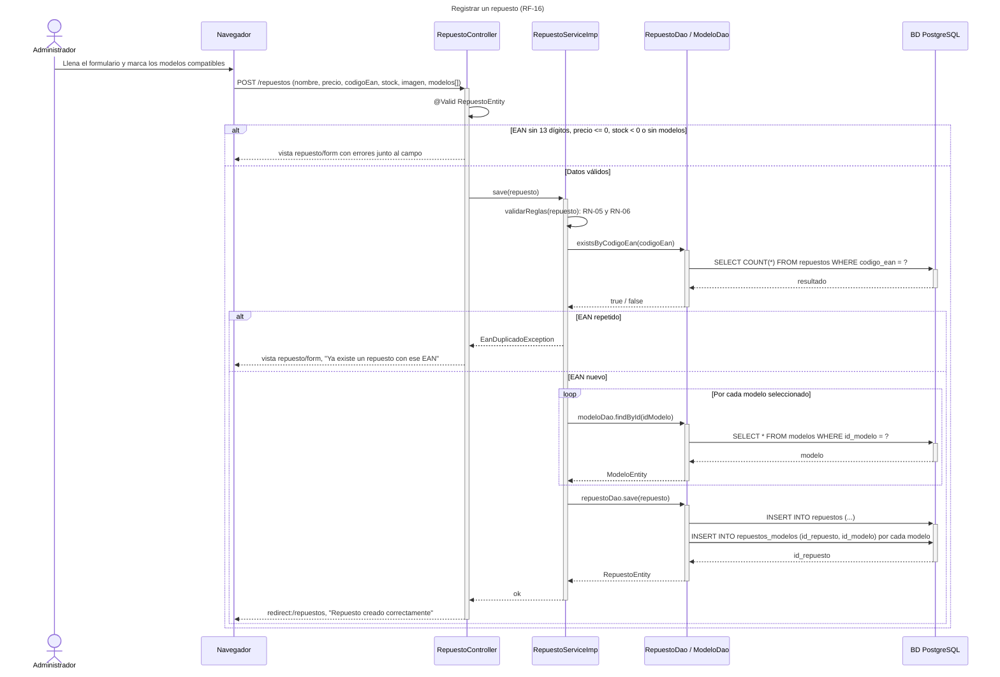
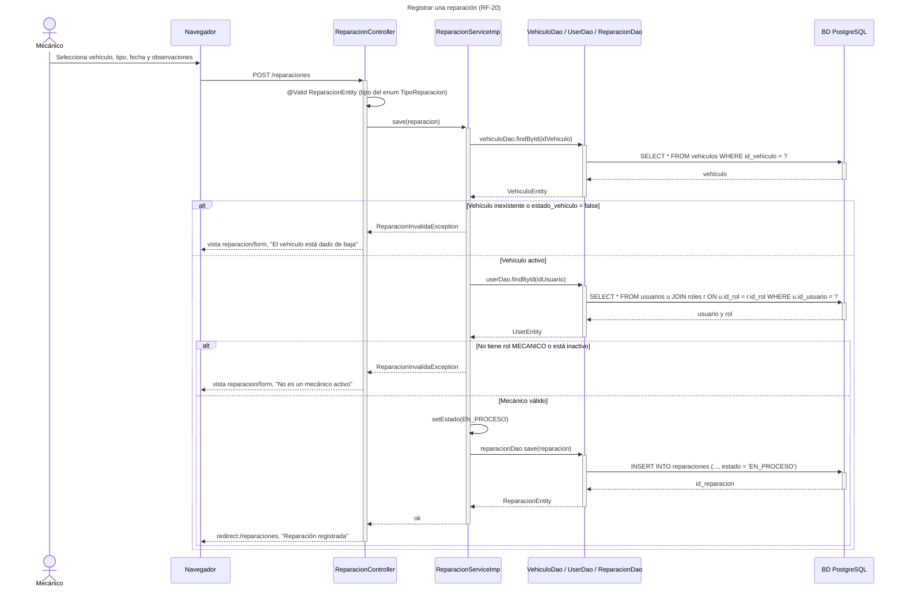
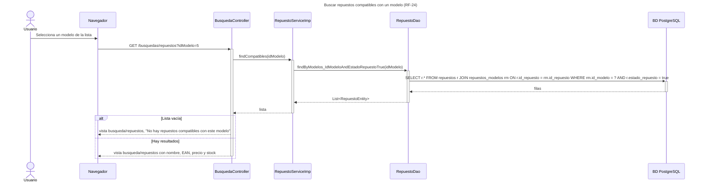
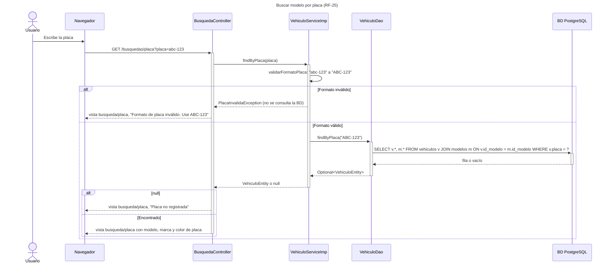
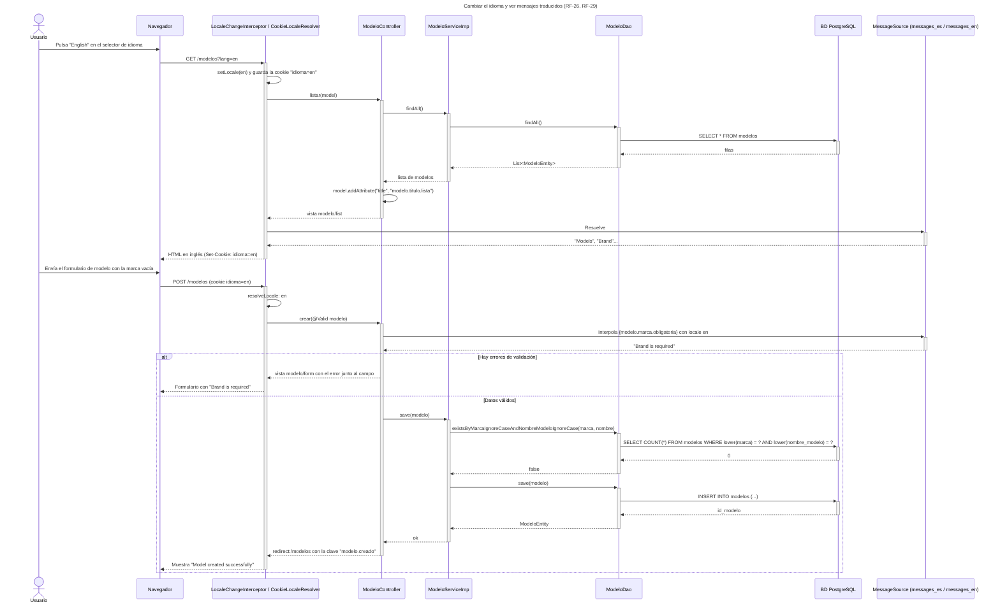

# Diagramas de secuencia – Primer avance

Pegue cada bloque en https://mermaid.live para verlo y exportarlo como PNG o SVG.

## 4.1 Inicio de sesión (RF-01, RF-03)

## 4.2 Registrar un vehículo (RF-12)

## 4.3 Registrar un repuesto (RF-16)

## 4.4 Registrar una reparación (RF-20)

## 4.5 Buscar repuestos compatibles con un modelo (RF-24)

## 4.6 Buscar modelo por placa (RF-25)

## 4.7 Funcionalidad de negocio: internacionalización (RF-26, RF-29)

